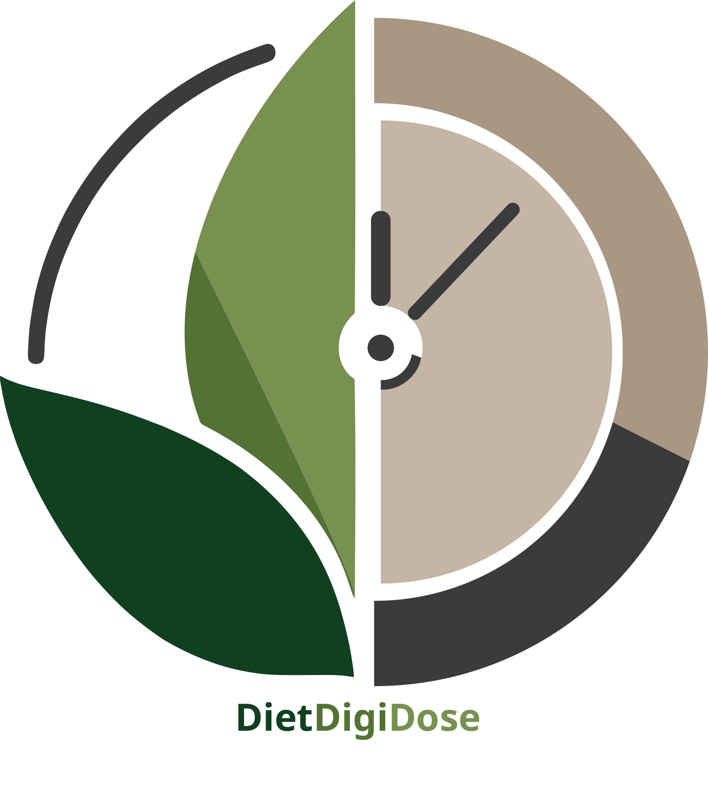

# DietDigiDose (食光烙记)

> **October 12 status:** It is W42 (October 12–18). Android `26w41a / 264101` is built; server `fbd9b1a4` is deployed with backup restoration, migrations and HTTPS smoke checks verified. See the [deployment record](docs/server-update-2026-10-11.md). Website changes are included in this branch but are not deployed. Real SMS recovery, APK download configuration and device acceptance remain pending.

<p align="center">
  
</p>

<p align="center">
  <strong>Turn what is already in your kitchen into the next meal you can actually cook.</strong>
</p>

<p align="center">
  <a href="README.md">简体中文</a> · English
</p>

DietDigiDose is an open-source food management application for individuals and small households. Starting with pantry inventory and expiry awareness, it connects recipe matching, shopping, cooking, stock deduction, and diet logging into one verifiable everyday workflow. Health profiles, community content, and safety-bounded AI assistance complement that core experience.

> [!IMPORTANT]
> The mobile client remains in its trusted Beta hardening phase and has not been publicly released. Nutrition estimates and AI output are for everyday reference only and are not medical diagnosis or treatment advice. Beta builds should not be used with real sensitive health data.

## Core experience

```text
Record household ingredients
  → identify available or expiring food
  → match recipes that can actually be cooked
  → finish cooking and deduct inventory
  → create a diet record automatically
```

The repository currently includes:

- Household inventory, expiry dates, kitchenware, and shopping lists
- Recipe matching based on inventory, expiring food, allergens, and available equipment
- A cooking queue and step mode with idempotent stock deduction and diet logging
- Nutrition intake, health profiles, reminders, and trend insights
- Recipe search, favorites, submissions, follows, and community content
- AI nutrition Q&A, ingredient and meal recognition, receipt scanning, and voice interaction
- An admin console for users, recipes, community content, Agent runs, AI configuration, and security audits

## Version and status

- **Current week:** `26w42` (ISO week 42 in Asia/Shanghai, October 12–18, 2026)
- **Repository version metadata:** `1.0.6` / `26w36a` / build `263601` (not the latest build artifact)
- **Latest successful Android build:** [`26w41a` / build `264101`](https://github.com/AdlinZ/DietDigiDose/actions/runs/38143602557), source commit `f4ba92c3`
- **Stage:** trusted Beta hardening
- **Last updated:** October 12, 2026

Main at `f4ba92c3` includes merged [PR #248](https://github.com/AdlinZ/DietDigiDose/pull/248): nutrition provenance, data import, dependency security, phone recovery and APK update support. [Main CI](https://github.com/AdlinZ/DietDigiDose/actions/runs/38143565538) passed, and Android preview `26w41a` was built successfully. Earlier review and validation records remain in the W41 history; the server was updated on October 11, while real-device acceptance remains pending.

On October 11, all **20 unfinished W41 issues** were carried into [W42](https://github.com/AdlinZ/DietDigiDose/milestone/12) (October 12–18), and W41 was archived as a weekly schedule. The scope includes: 18 carried over from W40, plus [#221 self-service password recovery](https://github.com/AdlinZ/DietDigiDose/issues/221) and [#219 in-app updates](https://github.com/AdlinZ/DietDigiDose/issues/219), added on October 7. Both are merged and included in 26w41a, and the server is deployed; real SMS delivery and Android device acceptance remain pending. Recovery supports verified phone bindings but not email; updates use complete APK packages, with OTA left for a later phase. See the [implementation and acceptance record](docs/w41-account-recovery-and-app-updates.md). Another 21 Backlog issues remain unscheduled. [W40](https://github.com/AdlinZ/DietDigiDose/milestone/10) retains its 4 closed issues as history. The website, admin console, API, PostgreSQL, and workers have recorded public deployment evidence; the latest server deployment is `w41-fbd9b1a4` (October 11), while the website and App web build retain their previous versions. Independent environment and persistence acceptance, a complete recovery exercise for the same candidate, and Android/iOS candidates from the same commit with real-device workflow evidence (#105, #106, and #107) remain the three P0 gates. Scheduling does not establish acceptance or promise completion of all 20 this week.

See the [W42 packaging readiness and execution plan](docs/milestone-26w42-progress.md), [development and Beta hardening checklist](TODO.md), and [device Beta checklist](docs/device-beta-checklist.md). The [W40 acceptance history](docs/milestone-26w40-progress.md) and [historical candidate records](docs/release-candidate-26w37a.md) retain existing evidence and original version metadata. Repository build metadata is allocated only before a new build; documentation updates do not create a candidate or increment its snapshot.

## Live services

| Entry | URL |
| --- | --- |
| Product website | [dietdigidose.top](https://dietdigidose.top/) |
| Admin console | [dietdigidose.top/login](https://dietdigidose.top/login) |
| API health check | [dietdigidose.top/api/v1/health](https://dietdigidose.top/api/v1/health) |

The ICP filing text and destination shown in the website footer are configured through **Site settings** in the admin console instead of being hard-coded in the frontend.

## Architecture

This repository is a pnpm workspace monorepo:

| Package | Main technologies | Purpose |
| --- | --- | --- |
| `client` | Expo 54, React Native, Expo Router, Uniwind | iOS, Android, and web client |
| `server` | Express, TypeScript, SQLite/PostgreSQL, Drizzle, LangGraph | API, business transactions, data, and AI Agent runtime |
| `admin` | React, Vite, Tailwind CSS | Moderation and system administration console |
| `deploy` | Docker Compose, Caddy | HTTPS deployment, persistence, and recovery exercises |

Local development uses SQLite by default, while the current public service uses PostgreSQL. Supabase remains optional object storage for community media; acceptance of an independent staging bucket is still pending.

## Repository layout

```text
Dietdigidose/
├── client/          # Expo routes, screens, components, and assets
├── server/          # Express API, database migrations, and import scripts
├── admin/           # React administration console
├── deploy/          # Staging deployment, proxy, and smoke-test configuration
├── docs/            # Product roadmap, acceptance checklists, and operations docs
├── eslint-plugins/  # Project-specific ESLint rules
└── scripts/         # Workspace and release validation scripts
```

## Quick start

### Requirements

- Node.js 22.23.2 (as specified in `.nvmrc` and `.node-version`)
- pnpm 10.18.0

### Install and configure

```bash
corepack enable
corepack prepare pnpm@10.18.0 --activate
pnpm install --frozen-lockfile
cp client/.env.example client/.env
cp server/.env.example server/.env
```

When using nvm, fnm, mise, or asdf, load the repository's Node version files first. Regular CI, Android builds, and the recommended local environment must use the same Node version; upgrades must update the version files, root package `engines`, and all workflows in one PR.

At minimum, point the client to the local API:

```dotenv
EXPO_PUBLIC_BACKEND_BASE_URL=http://localhost:9090
```

Development mode can use the default SQLite database and generate a local JWT secret automatically. Production and staging must define a strong `JWT_SECRET`, `ADMIN_INITIAL_PASSWORD`, and explicit `CORS_ORIGINS`, and connect to persistent PostgreSQL using `DATABASE_DRIVER=postgresql` and `DATABASE_URL`. See [`server/.env.example`](server/.env.example) for all settings.

### Run

Start Expo Web and the Express API:

```bash
pnpm dev
```

Start the admin console in another terminal:

```bash
pnpm dev:admin
```

Use `pnpm dev:all` if you need all three log streams in one terminal.

| Service | Default URL |
| --- | --- |
| Expo Web | `http://localhost:8080` |
| API | `http://localhost:9090` |
| Health check | `http://localhost:9090/api/v1/health` |
| Admin console | `http://localhost:5173` |

The local SQLite database is created automatically at `server/data/dietdigidose.db`; that directory is ignored by Git.

## Common commands

| Command | Purpose |
| --- | --- |
| `pnpm dev` | Start the client and API |
| `pnpm dev:admin` | Start the admin console |
| `pnpm dev:all` | Start the client, API, and admin console |
| `pnpm lint:all` | Check `client`, `server`, and `admin` |
| `pnpm test:all` | Run all automated tests |
| `pnpm test:coverage` | Run client/server coverage gates |
| `pnpm test:stability` | Run the full test suite twice and generate a stability report |
| `pnpm build:client` | Export the Expo web build |
| `pnpm build:server` | Build the Express server |
| `pnpm build:admin` | Build the admin console |
| `pnpm validate:toolchain` | Validate Node/pnpm versions against CI declarations |
| `pnpm validate:release` | Validate versions, snapshot, and native build numbers |
| `pnpm audit:prod` | Audit production dependencies |

See [layered testing and quality gates](docs/testing.md) for test layers, coverage, artifact budgets, and flaky/quarantine handling.

## Release and security boundary

`client/eas.json` contains iOS and Android preview and production profiles, and every distributable build requires an HTTPS API. Only local simulator development may explicitly use localhost HTTP, and it must not use real sensitive data.

A passing dependency audit does not mean “zero vulnerabilities.” As of October 6, 2026, main at `a22c6cb5` configures three narrow temporary audit exceptions and includes the project patch for `node-forge`. Draft PR #248 at `258d0dba` adds the `braces` patch and mandatory regression checks, bringing the exception count to four; that additional fix has not been merged or deployed. See [layered testing and quality gates](docs/testing.md) and [`pnpm-workspace.yaml`](pnpm-workspace.yaml) for exception rationale, patch validation, and review requirements. Review them after every dependency upgrade and before candidate acceptance.

Read these documents before deployment:

- [Development and Beta hardening checklist](TODO.md)
- [Product roadmap](docs/product-roadmap.md)
- [Operations and recovery guide](docs/operations.md)
- [Security policy](SECURITY.md)

## Data and third-party content

The project can import data from HowToCook, Open Food Facts, Wikibooks, USDA, and the Taiwan FDA. Imported records must retain source URLs, versions, and license metadata. Never commit local databases, backups containing user data, or real secrets.

See [THIRD_PARTY_NOTICES.md](THIRD_PARTY_NOTICES.md) for bundled source code, fonts, and recipe data. License copies are stored in [`LICENSES/`](LICENSES/).

## Project history

The DietDigiDose concept originated during a 2025 university software innovation competition. It received first prize in the Southwest regional round and third prize nationally in the [Software Design Innovation category of the 18th National College Student Software Innovation Competition](https://www.swcontest.com.cn/information?activeTab=notice&detailId=d6d9f4a293ba48f59cec8824ca901332).

The project restarted in 2026 with a new codebase. The [earlier competition repository](https://github.com/heathcetide/shiguang-brand) is preserved as historical material. The current implementation retains the name, problem context, and product vision, while its architecture, data model, and engineering implementation were redesigned for the current requirements.

## Contributing

Read [CONTRIBUTING.md](CONTRIBUTING.md) before submitting changes. Report security issues privately according to [SECURITY.md](SECURITY.md); do not publicly disclose an exploitable vulnerability.

## License

Project-owned source code is available under the [MIT License](LICENSE). Third-party components and content remain subject to their respective licenses.
